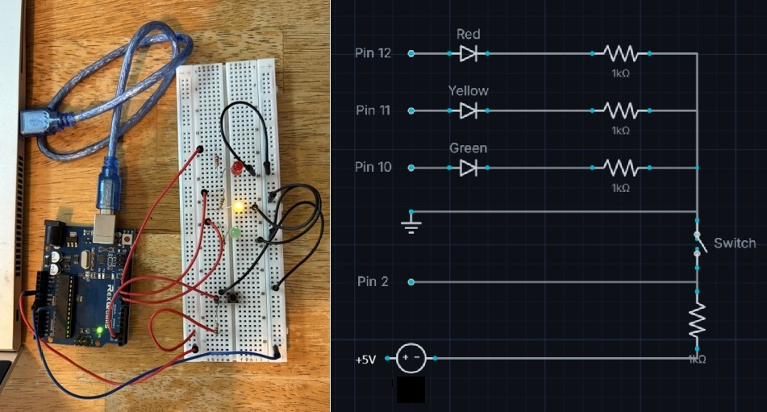
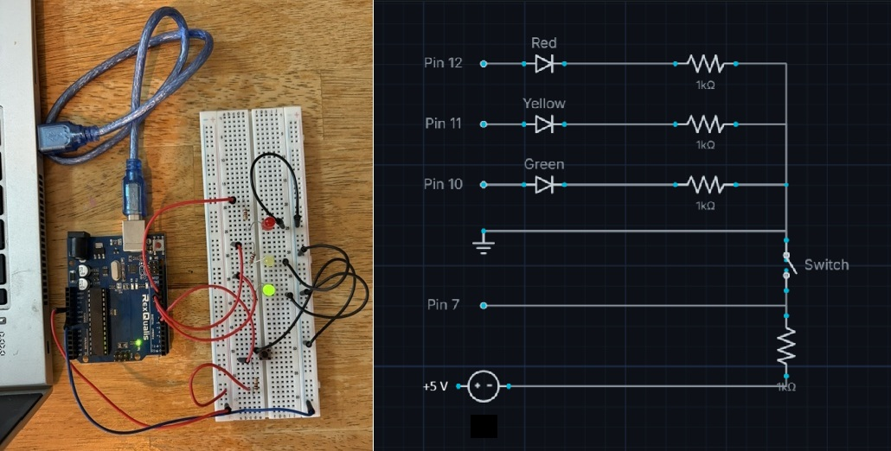

# How Arduino Uno Handles Interrupts

**Paul A. Jones, Jr.**  
**Published:** November 08, 2026  
**Report:** #8 — EmbeddedSystemsLab

**Professional interests:** Embedded Systems · Arduino · C Programming · Electronics · .NET  
**Contact:** [pauljonessoftware.com](https://pauljonessoftware.com) · [@paulajonesjr](https://github.com/paulajonesjr) · pauljonessoftware@gmail.com

---

## Table of Contents

- [Subject](#subject)
  - [Objective](#objective)
  - [Background](#background)
- [Arduino](#arduino)
  - [Interrupt Architecture](#interrupt-architecture)
- [Equipment List](#equipment-list)
- [Experiment 1: Traffic Light Circuit with External Interrupt](#experiment-1-traffic-light-circuit-with-external-interrupt)
  - [How It Works](#how-it-works)
  - [Sketch](#traffic-light-with-external-interrupt-sketch)
  - [Output](#traffic-light-with-external-interrupt-output)
- [Experiment 2: Traffic Light Circuit with Pin-Change Interrupt](#experiment-2-traffic-light-circuit-with-pin-change-interrupt)
  - [How It Works](#how-it-works-1)
  - [Sketch](#traffic-light-circuit-with-pin-change-interrupt-sketch)
  - [Output](#traffic-light-circuit-with-pin-change-output)
- [Why `volatile` Matters](#why-volatile-matters)
- [Experiment 3: The Timer Interrupt](#experiment-3-the-timer-interrupt)
- [Comparing the Three Interrupt Types](#comparing-the-three-interrupt-types)
- [Embedded Systems Engineering Glossary](#embedded-systems-engineering-glossary)
- [Engineering Reflection](#engineering-reflection)
- [Lessons Learned](#lessons-learned)
- [Learning in Public](#learning-in-public)
- [Action Items](#action-items)

## Subject

How to Wire Up a Traffic Light Simulator with a 4-Pin Tactile Push-Button Switch

### Objective

Demonstrate the use of External, Pin-Change, and Timer interrupts on the Arduino Uno and understand how interrupt service routines (ISRs) allow hardware events to modify the behavior of a running embedded system.

### Background

This report is a continuation of the report started on 11/02/2026. At that time, I realized that my proposed experiment had a couple of dependencies:

- Learning Pull-Up and Pull-Down Circuits
- Learning How to Wire Up a 4-Pin Tactile Push-Button Switch

I addressed both in the days that followed and was then able to move on and experiment with how the Arduino Uno handles interrupts. That is what is covered in this report.

## Arduino

The Arduino Uno has two dedicated external interrupt pins: Digital Pin 2 (INT0) and Digital Pin 3 (INT1). The Traffic Light Circuit with External Interrupt in this report uses Digital Pin 2 only. The PinChangeInterrupt library extends interrupt capability to additional digital pins by using the microcontroller's pin-change interrupt hardware.

### Interrupt Architecture

Unlike polling-based systems, interrupt-driven systems do not require the main program to continuously check for events. Instead, hardware automatically notifies the CPU when a specific condition occurs.

**General interrupt flow:**

```text
Button Press -> Voltage Transition -> Interrupt Trigger -> Interrupt Service Routine (ISR) -> System State Changes -> Normal Program Execution Resumes
```

An Interrupt is a signal or event that causes the CPU to temporarily suspend its normal program execution and respond to a specific event. After servicing the event, the CPU returns to its previous execution path and continues processing.

An Interrupt Service Routine (ISR) is a function executed in response to an interrupt request. It handles the event that triggered the interrupt, after which normal program execution resumes.

On the Arduino Uno, there are three Interrupt types: External, Pin Change and Timer.

- **External interrupts:** Dedicated interrupt inputs, INT0 and INT1, on digital pins 2 and 3.
- **Pin-change interrupts:** Allow changes on additional digital pins to trigger an interrupt.
- **Timer interrupts:** Generated by hardware timers when configured timing conditions are met.

This report covers all three.

## Equipment List

- 1 Arduino Uno Microcontroller
- 1 four-Pin Tactile Push-Button Switch
- 3 LEDs
  - 1 Green
  - 1 Yellow
  - 1 Red
- 4 × 1KΩ resistors
- Jumper wires
- Multimeter

To support the examples used in this report, I installed two third-party Interrupt libraries:

- **PinChangeInterrupt** allows a sketch to attach an interrupt service routine to supported digital pins when their logic state changes.
- **TimerOne** is a third-party library that provides an interface for configuring the Arduino Uno's Timer1 hardware timer. It can generate periodic interrupts at a specified interval.

## Experiment 1: Traffic Light Circuit with External Interrupt



*Figure 1. Traffic light circuit and schematic used for the external interrupt experiment.*

### How It Works

The traffic light circuit on the left and the schematic on the right in Figure 1 show the setup used for my external interrupt experiment. The logic shown in the sketch below controls the circuit's behavior. By default, the Red (stop), Yellow (caution), and Green (go) LEDs illuminate for 6, 2, and 6 seconds, respectively, cycling just like an actual traffic light.

The sketch also listens for interrupts on Arduino's digital pin #2, which is connected to the button switch. When the button is pressed, it generates an interrupt request, temporarily suspending normal program execution and calling the `changeTime()` Interrupt Service Routine (ISR).

The ISR changes the Go light's illumination time from 6 to 10 seconds, then returns control to the main program where execution resumes. The Go light remains at 10 seconds for subsequent cycles until the button is pressed again. The ISR then resets the illumination time to 6 seconds, and the cycle repeats.

### Traffic Light with External Interrupt Sketch

```cpp
/*
    Paul A. Jones, Jr.
    Objective: Using INT0 (Digital Pin 2)
    Date: 11082026
*/

int stop = 6;
int caution = 2;
volatile int go = 6;

void setup() {
    // put your setup code here, to run once:
    Serial.begin(9600);
    pinMode(13, OUTPUT);
    pinMode(10, OUTPUT);
    pinMode(11, OUTPUT);
    pinMode(12, OUTPUT);
    digitalWrite(13, LOW);
    digitalWrite(10, LOW);
    digitalWrite(11, LOW);
    digitalWrite(12, LOW);
    attachInterrupt(0, changeTime, FALLING);
}

void loop() {
    // put your main code here, to run repeatedly:
    stoplight(stop);
    golight(go);
    cautionlight(caution);
}

void stoplight(int time) {
    digitalWrite(10, LOW);
    digitalWrite(11, LOW);
    digitalWrite(12, HIGH);
    Serial.println("Light mode: Stop");
    delay(time * 1000);
}

void cautionlight(int time) {
    digitalWrite(10, LOW);
    digitalWrite(11, HIGH);
    digitalWrite(12, LOW);
    Serial.println("Light mode: Yield");
    delay(time * 1000);
}

void golight(int time) {
    digitalWrite(10, HIGH);
    digitalWrite(11, LOW);
    digitalWrite(12, LOW);
    Serial.print("Light mode: Go - ");
    Serial.println(time);
    delay(time * 1000);
}

void changeTime() {
    if(go == 6) {
        go = 10;
        digitalWrite(13, HIGH);
    } else {
        go= 6;
        digitalWrite(13, LOW);
    }
}
```

### Traffic Light with External Interrupt Output

```text
Light mode: Go - 6
Light mode: Yield
Light mode: Stop
Light mode: Go - 6
Light mode: Yield
Light mode: Stop
Light mode: Go - 6
Light mode: Yield
Light mode: Stop
Light mode: Go - 10
Light mode: Yield
Light mode: Stop
Light mode: Go - 10
Light mode: Yield
Light mode: Stop
Light mode: Go - 10
Light mode: Yield
Light mode: Stop
Light mode: Go - 10
Light mode: Yield
Light mode: Stop
Light mode: Go - 10
Light mode: Yield
Light mode: Stop
Light mode: Go - 6
Light mode: Yield
Light mode: Stop
```

## Experiment 2: Traffic Light Circuit with Pin-Change Interrupt



*Figure 2. Traffic light circuit and schematic used for the pin-change interrupt experiment.*

### How It Works

The pin-change traffic light circuit is wired up just like the external interrupt circuit, with one exception: instead of listening for interrupts on digital pin #2, it listens on pin #7. Both the circuit image and schematic in Figure 2 reflect this change.

As mentioned earlier, the Arduino Uno has only two dedicated external interrupt pins: 2 and 3. To extend interrupt capability to other digital pins, I installed a third-party library called PinChangeInterrupt. This library makes it possible to detect pin changes on additional digital inputs.

The following line of code is the key to making this work:

```cpp
attachPCINT(digitalPinToPCINT(7), changeTime, FALLING);
```

The `attachPCINT()` method is provided by the PinChangeInterrupt library. It tells the Arduino to monitor digital pin #7 and call the `changeTime()` ISR when the voltage transitions from HIGH to LOW (FALLING). Other than the change in interrupt mechanism and input pin, the circuit and sketch behave just as they did in the previous experiment.

### Traffic Light Circuit with Pin-Change Interrupt Sketch

```cpp
#include <PinChangeInterrupt.h>
#include <PinChangeInterruptBoards.h>
#include <PinChangeInterruptPins.h>
#include <PinChangeInterruptSettings.h>

/*
    Paul A. Jones, Jr.
    Objective: Using the pinchange library
    Date: 11082026
*/

int stop = 6;
int caution = 2;
volatile int go = 6;

void setup() {
    // put your setup code here, to run once:
    Serial.begin(9600);
    pinMode(7, INPUT);
    pinMode(13, OUTPUT);
    pinMode(10, OUTPUT);
    pinMode(11, OUTPUT);
    pinMode(12, OUTPUT);
    digitalWrite(13, LOW);
    digitalWrite(10, LOW);
    digitalWrite(11, LOW);
    digitalWrite(12, LOW);

    attachPCINT(digitalPinToPCINT(7), changeTime, FALLING);
}

void loop() {
    // put your main code here, to run repeatedly:
    stoplight(stop);
    golight(go);
    cautionlight(caution);
}

void stoplight(int time) {
    digitalWrite(10, LOW);
    digitalWrite(11, LOW);
    digitalWrite(12, HIGH);
    Serial.println("Light mode: Stop");
    delay(time * 1000);
}

void cautionlight(int time) {
    digitalWrite(10, LOW);
    digitalWrite(11, HIGH);
    digitalWrite(12, LOW);
    Serial.println("Light mode: Yield");
    delay(time * 1000);
}

void golight(int time) {
    digitalWrite(10, HIGH);
    digitalWrite(11, LOW);
    digitalWrite(12, LOW);
    Serial.print("Light mode: Go - ");
    Serial.println(time);
    delay(time * 1000);
}

void changeTime() {
    if(go == 6) {
        go = 10;
        digitalWrite(13, HIGH);
    } else {
        go= 6;
        digitalWrite(13, LOW);
    }
}
```

### Traffic Light Circuit with Pin-Change Output

The output from this sketch is much like the External Interrupt experiment, with a few differences. I allowed the default states to cycle twice, so the output initially displays two "Go-6" entries. I then press the button, triggering a pin change interrupt on digital pin #7. The sketch temporarily suspends normal execution and calls the ISR, which changes the Go state variable from 6 to 10 seconds before returning control to the main program.

Later, I press the button again, triggering another interrupt. This time, the ISR resets the Go variable to its original value of 6 seconds. You can see this change in the output when "Go-10" transitions back to "Go-6."

```text
Light mode: Stop
Light mode: Go - 6
Light mode: Yield
Light mode: Stop
Light mode: Go - 6
Light mode: Yield
Light mode: Stop
Light mode: Go - 10
Light mode: Yield
Light mode: Stop
Light mode: Go - 10
Light mode: Yield
Light mode: Stop
Light mode: Go - 10
Light mode: Yield
Light mode: Stop
Light mode: Go - 10
Light mode: Yield
Light mode: Stop
Light mode: Go - 6
Light mode: Yield
Light mode: Stop
```

## Why `volatile` Matters

Variables shared between an interrupt service routine and the main program may change unexpectedly from the compiler's perspective.

**Example:**

```cpp
volatile int go = 6;
```

The `volatile` keyword tells the compiler not to optimize (cache and reuse the variable `go` in this case) but remain on the lookout for this possibility.

## Experiment 3: The Timer Interrupt

The timer interrupt exercise is straightforward, but it did require a third-party library install.

```cpp
/*
    Paul A. Jones, Jr.
    Objective: sketch1603
    Date: 11082026

    Description: This sketch
         1. Calls the timer ISR blinkme() every 5 seconds.
         2. Illuminates the LED for 5 seconds.
         3. Toggles the LED off for 5 seconds.
         4. Repeats.

    blinkme() alternates between setting the built-in LED on the Arduino board at pin 13
    HIGH and LOW.
*/

#include <TimerOne.h>

volatile int state = 0;

void setup() {
    // put your setup code here, to run once:
    pinMode(13, OUTPUT);
    digitalWrite(13, state);
    Timer1.initialize(5000000);
    Timer1.attachInterrupt(blinkme);
}

void blinkme() {
    state = !state;
    digitalWrite(13, state);
}

void loop() {
    // put your main code here, to run repeatedly:
}
```

There is no circuit build with this experiment.

## Comparing the Three Interrupt Types

### External Interrupts

**Advantages**

- Built into the Arduino Uno hardware.
- Simple to configure.
- Fast and predictable.

**Limitations**

- Limited to pins 2 and 3.

### Pin-Change Interrupts

**Advantages**

- Available on many additional digital pins.
- Provides greater flexibility in circuit design.

**Limitations**

- Requires additional setup.
- Often relies on a third-party library for convenience.

### Timer Interrupts

**Advantages**

- Do not require user interaction.
- Ideal for periodic tasks and scheduling.

**Limitations**

- Tied to hardware timer resources.
- Must be managed carefully if other libraries require the same timer.

## Embedded Systems Engineering Glossary

New terms added to the glossary.

- **Callback** – A function passed to another function or subsystem that is executed when a specified event occurs.
- **External Interrupt** – A hardware interrupt generated by dedicated interrupt pins on a microcontroller.
- **Flash Memory** – Nonvolatile memory used to store the Arduino program (sketch) and other data that must remain available when power is removed.
- **Pin-Change Interrupt** – An interrupt generated when a monitored digital input changes state.
- **Timer Interrupt** – An interrupt generated automatically by a hardware timer when a configured timing condition occurs.
- **Volatile** – A C/C++ keyword that tells the compiler that a variable's value may change unexpectedly outside the normal flow of program execution, such as when modified by an interrupt service routine. It prevents the compiler from making certain assumptions or optimizations that could cause it to overlook those changes.

## Engineering Reflection

This experiment reinforced how closely interrupts resemble event-driven programming concepts found in traditional software development. As a veteran programmer, it was natural to view an ISR as a hardware-generated callback that executes in response to an external event. The important distinction is that the event originates in hardware rather than software. This realization made interrupts much easier to understand and helped connect my software experience to embedded systems development.

I struggled a bit with the PinChangeInterrupt 3rd party library import. It took three sit-down sessions before I successfully figured out how to get it done. The struggle was worth the effort though. Now, I can confidently clone any library from GitHub or download it as a zip file and install it into the environment. I suspect that this is a fundamental part of Arduino development so understanding how to do it was extremely important.

## Lessons Learned

- Interrupts allow hardware events to influence program behavior without requiring continuous polling.
- Pull-up and pull-down circuits are foundational to reliable button-driven interrupts.
- An ISR behaves similarly to an event handler or callback but is triggered directly by hardware.
- The `volatile` keyword is important when variables are shared between the main program and an ISR.
- Understanding the dependencies between concepts leads to deeper learning than studying topics in isolation.

## Learning in Public

### GitHub

- **Published to:** EmbeddedSystemsLab
- **Report Number:** #8

### Primary Topics

- External Interrupts
- Pin-Change Interrupts
- Timer Interrupts
- ISR Design
- `volatile`

## Action Items

- Next chapter: Serial Communication Protocols
