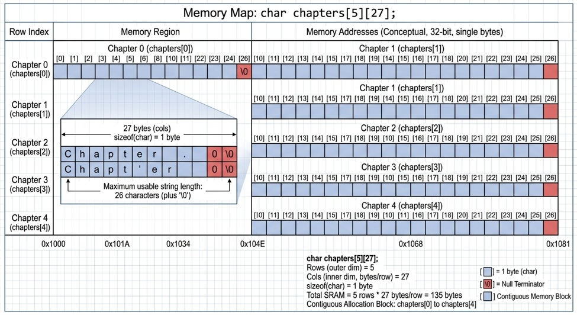

# Field Report: C String Management & Embedded Vocabulary

**Engineer:** Paul A. Jones, Jr.  
**Date:** October 19, 2026  
**Mission:** Explore static two-dimensional arrays versus pointer-based string storage in C, analyze memory layouts, and expand the embedded systems glossary.

---

## 1. Summary

Today's session focused on low-level string management and memory organization in C. By constructing and analyzing `ragged.c`, I compared a fixed-size, contiguous two-dimensional character array against an array of character pointers.

Using `sizeof()`, array indexing, and pointer arithmetic, I examined the differences in storage requirements and traversal techniques.

I also began developing an **Embedded Engineering Glossary**, starting with RTOS (Real-Time Operating System), an important concept in embedded software development.

### Key Findings

- A two-dimensional character array stores its character data directly in a contiguous block of memory.
- An array of character pointers stores addresses rather than the string characters themselves.
- `sizeof()` measures the storage occupied by its operand, while `strlen()` measures the number of characters before a string's terminating null character.
- Array indexing and pointer arithmetic can provide equivalent ways to access array elements.

---

## 2. Embedded Systems Vocabulary Builder

### Term: RTOS

**RTOS — Real-Time Operating System**

A real-time operating system is designed to provide predictable timing behavior so that tasks can respond to events and meet defined timing constraints.

Unlike general-purpose operating systems, which often prioritize throughput, resource sharing, and interactive workloads, an RTOS is designed with real-time scheduling and response requirements in mind.

Common application areas include:

- Industrial control systems
- Robotics
- Automotive electronics
- Medical devices
- Sensor-driven applications
- Embedded controllers
- Aerospace and defense systems

**Key takeaway:** In real-time systems, meeting a timing deadline can be more important than completing a task as quickly as possible on average.

An RTOS does not automatically guarantee that every deadline will be met. That depends on the system design, task scheduling, execution times, interrupt handling, and resource management.

---

## 3. C Programming Laboratory

### Program: `ragged.c`

**Topic:** Contiguous two-dimensional arrays versus character pointer arrays.

### Objective

Compare these declarations:

```c
char chapters[5][27];
```

and:

```c
const char* chapters_ptr[5];
```

Investigate:

- Memory allocation and storage layout
- Array and pointer sizes
- String storage
- Array traversal
- Pointer arithmetic
- The relationship between array indexing and pointers

### Complete Source Code

```c
/*******************************************************************************
 *
 * File:        ragged.c
 * Author:      Paul A. Jones, Jr.
 * Created:     [2026-10-19]
 * Description: Demonstrates C string and memory management by contrasting
 *              a contiguous 2D static array against an array of character
 *              pointers. Compares memory footprints via sizeof and
 *              illustrates dual traversal using both standard array indexing
 *              and explicit pointer arithmetic.
 *
 * Target:      Native Desktop
 *
 * License:     MIT License (or your preferred publishing terms)
 * Blog/Ref:    https://pauljonessoftware.com
 *
 ******************************************************************************/

#include <stdio.h>

/* Set the different chapter titles as constant macros. */
#define CHAPTER0 "Introduction"
#define CHAPTER1 "Getting Started with C"
#define CHAPTER2 "Introduction to Data Types"
#define CHAPTER3 "Working with Numbers"
#define CHAPTER4 "Control Structures"

int main(void) {

    /* Create a multi-dimensional chapter array. */
    char chapters[5][27] = {
        CHAPTER0,
        CHAPTER1,
        CHAPTER2,
        CHAPTER3,
        CHAPTER4
    };

    /* Create an array of character pointers. */
    const char* chapters_ptr[5] = {
        CHAPTER0,
        CHAPTER1,
        CHAPTER2,
        CHAPTER3,
        CHAPTER4
    };

    /* Print the memory requirements of each variable. */
    printf("The chapters array uses %zu bytes of memory.\n",
        sizeof(chapters));

    printf("The chapters_ptr array uses %zu bytes of memory.\n\n",
        sizeof(chapters_ptr));  // 20 bytes on a typical 32-bit system

    char myName[] = "Paul";
    char *pMyName = myName;

    /* Print memory requirements for each variable. */
    printf("The myName array uses %zu bytes of memory.\n",
        sizeof(myName));

    printf("The myName pointer uses %zu bytes of memory.\n\n",
        sizeof(pMyName));  // 4 bytes on a typical 32-bit system

    /* Calculate the number of elements (rows) in the array. */
    size_t counter = sizeof(chapters) / sizeof(chapters[0]);

    printf("The number of chapters (rows) in the array is %zu.\n\n",
        counter);

    /* Iterate using array indexing. */
    for (size_t i = 0; i < counter; i++) {
        printf("chapters[%zu] is %s\n", i, chapters[i]);
    }

    printf("\n");

    /* Iterate using pointer arithmetic. */
    for (size_t i = 0; i < counter; i++) {
        printf("(chapters_ptr + %zu) is %s\n",
            i, *(chapters_ptr + i));
    }

    return 0;
}
```

---

## 4. Memory Layout Analysis

### A. Contiguous Two-Dimensional Array

The declaration:

```c
char chapters[5][27];
```

allocates storage for five rows, each containing 27 characters.



Assuming one byte per `char`:

\[
5 \times 27 = 135 \text{ bytes}
\]

Each row can hold up to 26 string characters plus the terminating null character (`'\0'`).

Conceptual memory layout:

```text
chapters
+-----------------------------+
| Row 0: 27 characters        |
+-----------------------------+
| Row 1: 27 characters        |
+-----------------------------+
| Row 2: 27 characters        |
+-----------------------------+
| Row 3: 27 characters        |
+-----------------------------+
| Row 4: 27 characters        |
+-----------------------------+

Total array storage: 135 bytes
```

The rows are contiguous, and each row has the same fixed capacity. Shorter strings leave unused space within their rows.

### B. Array of Character Pointers

The declaration:

```c
const char* chapters_ptr[5];
```

creates an array containing five pointers to constant characters.

Conceptual layout:

```text
chapters_ptr
+--------------------+
| Pointer 0          | ----> "Introduction"
+--------------------+
| Pointer 1          | ----> "Getting Started with C"
+--------------------+
| Pointer 2          | ----> "Introduction to Data Types"
+--------------------+
| Pointer 3          | ----> "Working with Numbers"
+--------------------+
| Pointer 4          | ----> "Control Structures"
+--------------------+
```

The pointer array stores addresses, not copies of the string characters.

The string literals have static storage duration and are not allocated on the heap by this program. The size of the pointer array alone does not account for the storage occupied by those literals.

### C. Comparing Storage Requirements

| Declaration | Typical 32-bit size | Typical 64-bit size |
|---|---:|---:|
| `char chapters[5][27]` | 135 bytes | 135 bytes |
| `const char* chapters_ptr[5]` | 20 bytes | 40 bytes |
| `char myName[] = "Paul"` | 5 bytes | 5 bytes |
| `char *pMyName = myName` | 4 bytes | 8 bytes |

Pointer sizes shown are typical platform examples, not universal guarantees.

The `sizeof(chapters_ptr)` result measures only the pointer array. It excludes the storage occupied by the string literals.

---

## 5. Array Indexing and Pointer Arithmetic

### Array Indexing

```c
chapters[i]
```

This expression accesses the `i`th row of the two-dimensional array.

### Pointer Arithmetic

```c
*(chapters_ptr + i)
```

This expression advances the pointer to the `i`th element of the pointer array and dereferences it to obtain the stored character pointer.

The following expressions are equivalent:

```c
chapters_ptr[i]
```

```c
*(chapters_ptr + i)
```

Pointer arithmetic scales by the size of the pointed-to type. Here, `chapters_ptr` points to elements of type `const char *`, so adding one advances to the next pointer element.

Both traversal approaches produce the same chapter titles, although they operate on different data structures.

---

## 6. Understanding `sizeof()` and `strlen()`

Consider the following declarations:

```c
char myName[] = "Paul";
char *pMyName = myName;
```

The array contains five bytes:

```text
+---+---+---+---+------+
| P | a | u | l | '\0' |
+---+---+---+---+------+
```

The null terminator is part of the array's storage.

| Expression | What it measures | Typical result |
|---|---|---:|
| `sizeof(myName)` | Total array storage | 5 bytes |
| `sizeof(pMyName)` | Pointer storage | 4 or 8 bytes |
| `strlen(myName)` | Characters before `'\0'` | 4 |
| `strlen(pMyName)` | Characters before `'\0'` | 4 |

`sizeof()` and `strlen()` answer different questions:

- **`sizeof()`** measures the size of its operand. When the operand is an array, it reports the complete array size.
- **`strlen()`** counts the characters before the first null character. It does not include the terminator.

A pointer does not retain the size of the array it points to. Consequently, `sizeof(pMyName)` measures the pointer, not the character array.

---

## 7. Lessons Learned

### Contiguous Character Arrays

**Advantages**

- Predictable storage requirements
- Contiguous character data
- Straightforward indexing
- No separate pointer array required

**Trade-offs**

- Fixed capacity for each row
- Potential unused space when strings are shorter than their rows

### Character Pointer Arrays

**Advantages**

- Can reference strings of different lengths
- Avoids reserving a fixed-size character buffer for every entry
- Supports flexible arrangements of string references

**Trade-offs**

- Requires pointer storage in addition to the referenced characters
- Adds a level of indirection
- Requires care with string lifetimes and mutability

### Engineering Principle

Different data structures can produce identical output while having different memory costs and access patterns.

Understanding these differences is important when choosing data representations for memory-constrained embedded applications.

---

## 8. Embedded Engineering Glossary

### Current Entries

| Acronym or Term | Meaning |
|---|---|
| RTOS | Real-Time Operating System |

### Planned Additions

- ISR — Interrupt Service Routine
- GPIO — General-Purpose Input/Output
- PWM — Pulse-Width Modulation
- ADC — Analog-to-Digital Converter
- DAC — Digital-to-Analog Converter
- Watchdog Timer
- UART — Universal Asynchronous Receiver/Transmitter
- SPI — Serial Peripheral Interface
- I²C — Inter-Integrated Circuit

---

## 9. Action Items

### Extend `ragged.c`

Add:

```c
#include <string.h>
```

Then use `strlen()` to measure the actual lengths of the chapter titles.

Compare the string lengths against the fixed row capacity and, where applicable, the results from `sizeof()`.

### Expand the Embedded Glossary

Continue documenting foundational concepts related to:

- Interrupt handling
- Digital and analog interfaces
- Timers and counters
- Communication protocols
- Memory-mapped registers
- Hardware abstraction layers

### Apply the Concepts

Use future Arduino and C exercises to reinforce the relationship between data representation, memory organization, and hardware constraints.

---

## 10. Engineering Reflection

Today's exercise continues a recurring theme in my embedded systems studies:

> Syntax becomes more meaningful when viewed through the lens of memory.

The experiment demonstrated that two structures may produce similar output while using fundamentally different storage strategies.

Understanding those differences is important because embedded systems often require careful consideration of memory usage, memory layout, and storage efficiency.

Each pointer experiment continues to reveal that what appears to be a simple language feature can provide a direct window into how a computer organizes and accesses data.

---

## Mission Status

**Completed**

### Key Takeaway

> Character arrays store character data directly.
>
> Pointer arrays store addresses of character data.
>
> `sizeof()` measures storage, while `strlen()` measures string length.
>
> Understanding the difference is essential for effective C programming and embedded systems development.
