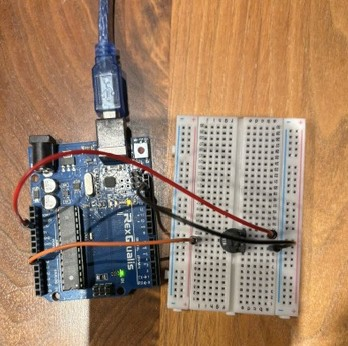

# Arduino, C Programming & Embedded Systems Field Report

**Engineer:** Paul A. Jones, Jr.  
**Date:** October 17, 2026  
**Mission:** Integrate the B103 potentiometer with the Arduino platform and continue building a deeper understanding of memory, pointers, and embedded systems concepts.

---

## Executive Summary

Today's work marked a significant milestone in the potentiometer investigation. After identifying the component, measuring its resistance, determining its pinout, and using it as a variable resistor in a standalone LED circuit, I successfully integrated it with the Arduino as an analog input device.

The experiment demonstrated how a physical adjustment to a hardware component can be translated into a software-readable value. This effectively bridged the gap between electronics and software and provided a practical demonstration of `analogRead()`.

On the C programming side, I wrote a small experiment to investigate pointer arithmetic. The results confirmed that pointers advance through memory according to the size of the data type they reference rather than moving one byte at a time.

The day concluded with further investigation of SRAM, DRAM, stack memory, and heap memory, along with plans to begin publishing field reports to GitHub as a public learning journal.

---

## Arduino Laboratory

### Topic: Reading a Potentiometer Using Analog Input

#### Objective
Connect a B103 potentiometer to the Arduino and capture its output using `analogRead()`.

#### Circuit Description


*Figure 1. Arduino potentiometer experiment: Arduino Uno connected to a breadboard-mounted potentiometer. Jumper wires establish the circuit connections for investigating the component's behavior under program control.*

**Components Used:**
* Arduino Uno
* B103 Potentiometer
* Three jumper wires

**Pin Connections:**
* `J1`: Arduino +5V → Potentiometer
* `J2`: Arduino A0 → Potentiometer Wiper
* `J3`: Arduino GND → Potentiometer

> **Note:** Configured as a voltage divider using +5V.

#### Arduino Sketch

```cpp
int input;

void setup() {
    Serial.begin(9600);
}

void loop() {
    input = analogRead(A0);
    Serial.print("The current value is ");
    Serial.println(input);
    delay(3000);
}
```

#### Observations
The potentiometer output was successfully captured using `analogRead(A0)`. The resulting values ranged between **0 → 1023**, which corresponds to the Arduino's 10-bit Analog-to-Digital Converter (ADC).

**Sample Output:**
```text
661
662
670
704
730
765
804
851
876
885
```

As the potentiometer was adjusted, the output values changed smoothly. This provided direct evidence of the signal conversion pipeline:

$$\text{Physical Rotation} \longrightarrow \text{Voltage Change} \longrightarrow \text{ADC Conversion} \longrightarrow \text{Numeric Value}$$

#### Key Discovery
The potentiometer has officially transitioned from an **Unknown Component** to a **Verified Component** with a complete knowledge profile:
- [x] Resistance measured
- [x] Pinout determined
- [x] Variable-resistance circuit built
- [x] Arduino interface built
- [x] Analog value acquisition verified

#### Engineering Takeaway
For the first time, a physical control on the workbench directly influenced software output. This experiment demonstrated one of the foundational concepts of embedded systems:

$$\text{Hardware Input} \longrightarrow \text{Software Interpretation} \longrightarrow \text{Program Behavior}$$

---

## C Programming Laboratory

### Topic: Pointer Arithmetic

#### Objective
Answer a fundamental question: *Does a pointer move through memory one byte at a time, or does it move according to the size of the data type being referenced?*

#### Experimental Design
Two arrays were created:
```c
int i[] = {1, 2, 3, 4, 5};
char c[] = {'a', 'b', 'c', 'd', 'e'};
```
along with corresponding pointers:
```c
int *pI = i;
char *pC = c;
```

The addresses generated by `pI + index` and `pC + index` were displayed and compared.

#### Findings

* **Integer Array:** Since $\text{sizeof}(\text{int}) = 4\text{ bytes}$ on the test machine, each increment advanced the address by 4 bytes.
  * Conceptually: `0x1000` $\rightarrow$ `0x1004` $\rightarrow$ `0x1008` $\rightarrow$ `0x100C` $\rightarrow$ `0x1010`
* **Character Array:** Since $\text{sizeof}(\text{char}) = 1\text{ byte}$, each increment advanced the address by 1 byte.
  * Conceptually: `0x2000` $\rightarrow$ `0x2001` $\rightarrow$ `0x2002` $\rightarrow$ `0x2003` $\rightarrow$ `0x2004`

#### Conclusion
The experiment verified that pointer arithmetic is **type-aware**. Pointers do not move one byte at a time unless they point to single-byte data.

$$\text{Pointer Increment Size} = \text{Size of Referenced Type}$$

* `int*` advances by $\text{sizeof}(\text{int})$
* `char*` advances by $\text{sizeof}(\text{char})$

#### Relationship to Previous Experiments
This experiment builds directly upon earlier discoveries:

| Previous Finding | Today's Finding |
| :--- | :--- |
| All pointer types occupy the same amount of memory. | All pointer types occupy the same amount of memory, **but they traverse memory differently.** |

Together, these experiments provide a deeper understanding of how C interprets addresses and manages memory.

---

## Embedded Systems Research

### Memory Investigation
Spent additional time researching and reviewing the relationship between:
* SRAM vs. DRAM
* Stack Memory vs. Heap Memory

#### Areas of Interest
1. Static Storage
2. Stack Allocation
3. Heap Allocation
4. Runtime Resource Management
5. Embedded systems memory mapping & constraints

---

## Engineering Reflection

A few weeks ago, the potentiometer was simply a component with an unfamiliar label: `B103`. Today, its resistance has been measured, its pinout verified, the component wired into multiple circuits, and its output captured through software.

This progression reinforces a recurring lesson: **Understanding is built through experimentation, not memorization.**

The same pattern applies to pointers. Rather than accepting descriptions from a textbook, small experiments were written to verify how pointer sizes and pointer arithmetic actually behave in execution.

---

## Future Development

### Immediate Next Objective
Return to the Arduino traffic light project and integrate the potentiometer into the design.

**Potential Enhancements:**
* Adjustable timing delays
* User-controlled cycle speed
* Exploration of `map()` and `constrain()`
* PWM-based control experiments

### Professional Development
Begin publishing field reports and experiments to GitHub.

**Goals:**
* Build a public learning repository
* Document engineering progress
* Create a portfolio of embedded systems work
* Demonstrate continuous technical growth

---

## Mission Assessment

### Arduino
* [x] Wired and tested potentiometer input circuit
* [x] Captured analog values using `analogRead()`
* [x] Verified 0–1023 ADC output range
* [x] Successfully connected hardware input to software output

### C Programming
* [x] Investigated pointer arithmetic
* [x] Confirmed type-aware pointer traversal
* [x] Reinforced previous pointer-size discoveries
* [x] Expanded memory model understanding

### Engineering Development
* [x] Continued studying memory architecture
* [x] Planned GitHub documentation strategy
* [x] Ready to enhance the traffic light project

---

## Summary & Status

### Major Takeaway
Today's work completed an important learning loop:

$$\text{Identify Component} \longrightarrow \text{Measure} \longrightarrow \text{Pinout} \longrightarrow \text{Build Circuit} \longrightarrow \text{Read in Software} \longrightarrow \text{Project Integration}$$

The potentiometer is no longer a mystery component; it is now a fully understood input device that can be used confidently in future embedded systems projects.

**Mission Status:** `SUCCESSFUL`

> *"Every experiment removes another layer of mystery. Today, a potentiometer became software."*