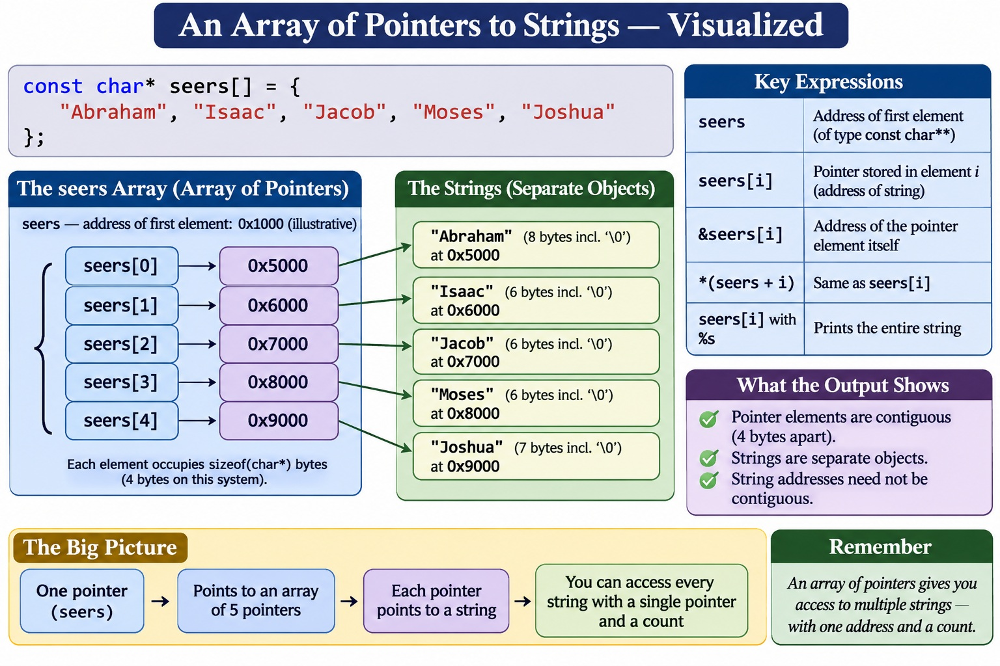

# Field Report: C Arrays of Pointers & Memory Layout

**Engineer:** Paul A. Jones, Jr.\
**Date:** October 30, 2026\
**Mission:** Investigate array-to-pointer conversion in C, examine the
memory layout of an array of string pointers, and demonstrate pointer
arithmetic and indirection by inspecting actual addresses.

------------------------------------------------------------------------

## Objective

This exercise began with a simple array of names and developed into a
closer examination of how C represents arrays and pointers in memory.

The program uses an array of pointers to string literals, passes that
array to functions, and prints several addresses to distinguish:

-   The address of the complete array object.
-   The address of an individual pointer element.
-   The address of the string to which that pointer refers.
-   The string value itself.

The goal was to connect C pointer expressions to observable memory
behavior rather than treating pointer syntax as an abstract language
feature.

## The Program

The declaration below creates an array containing five pointers to
constant characters. Each pointer refers to a string literal.

``` c
const char* seers[] = {
    "Abraham",
    "Isaac",
    "Jacob",
    "Moses",
    "Joshua"
};
```

The complete program follows.

``` c
/*******************************************************************************
 *
 * File:        Prophets.c
 * Author:      Paul A. Jones, Jr.
 * Created:     [2026-10-30]
 * Description: Demonstrates array-to-pointer conversion, pointer arithmetic,
 *              indirection, and the memory layout of an array of string pointers.
 *
 * Target:      Native Desktop
 * Blog/Ref:    https://pauljonessoftware.com
 *
 ******************************************************************************/

#include <stdio.h>

void displaySeers(const char** seers, size_t numberOfElements);
void displaySeers2(const char** seers, size_t numberOfElements);

int main(void) {

    // This is an array of pointers to constant characters.
    const char* seers[] = {
        "Abraham",
        "Isaac",
        "Jacob",
        "Moses",
        "Joshua"
    };

    // Size of a char pointer on this system.
    size_t sizeOfCharPointer = sizeof(char*);
    printf("\\nSize of a char* on this system is %zu bytes.\\n\\n",
           sizeOfCharPointer);

    // Compare the array address, first element address, and string address.
    printf("Address of the entire array (&seers): %p.\\n", (void*)&seers);
    printf("Address of the first array element (seers): %p.\\n", (void*)seers);
    printf("Address of the first pointer slot (&seers[0]): %p.\\n",
           (void*)&seers[0]);
    printf("Address of the first string (seers[0]): %p.\\n\\n",
           (void*)seers[0]);

    // Manually walk through the string addresses using array syntax.
    int count = 0;
    printf("Using array syntax ...\\n");
    printf("Seer[%d] is at %p.\\n", count, (void*)seers[count]); count++;
    printf("Seer[%d] is at %p.\\n", count, (void*)seers[count]); count++;
    printf("Seer[%d] is at %p.\\n", count, (void*)seers[count]); count++;
    printf("Seer[%d] is at %p.\\n", count, (void*)seers[count]); count++;
    printf("Seer[%d] is at %p.\\n\\n", count, (void*)seers[count]); count++;

    // Walk through the same string addresses using pointer arithmetic.
    count = 0;
    printf("Using pointer arithmetic ...\\n");
    printf("Seer[%d] is at %p.\\n", count, (void*)*(seers + count)); count++;
    printf("Seer[%d] is at %p.\\n", count, (void*)*(seers + count)); count++;
    printf("Seer[%d] is at %p.\\n", count, (void*)*(seers + count)); count++;
    printf("Seer[%d] is at %p.\\n", count, (void*)*(seers + count)); count++;
    printf("Seer[%d] is at %p.\\n\\n", count, (void*)*(seers + count)); count++;

    // Determine the number of elements while seers is still an array.
    size_t numberOfElements = sizeof(seers) / sizeof(seers[0]);

    // Display the string values and the addresses where the strings begin.
    displaySeers(seers, numberOfElements);
    printf("\\n");

    // Display each pointer element's address, its stored string address,
    // and the string value.
    displaySeers2(seers, numberOfElements);

    return 0;
}

void displaySeers(const char** seers, size_t numberOfElements) {
    for (size_t i = 0; i < numberOfElements; i++) {
        printf("%s is stored at address %p.\\n",
               *(seers + i), (void*)*(seers + i));
    }
}

// Each pointer element occupies sizeof(char*) bytes.
// Pointer arithmetic advances from one array element to the next.
void displaySeers2(const char** seers, size_t numberOfElements) {
    for (size_t i = 0; i < numberOfElements; i++) {
        printf("Element %zu is at %p; string begins at %p; value = %s\\n",
               i,
               (void*)&seers[i],
               (void*)seers[i],
               seers[i]);
    }
}

```



## Execution

The program was compiled and executed in Windows PowerShell using MinGW.
The observed output was:

``` text
Size of a char* on this system is 4 bytes.

Address of the entire array (&seers): 0061FF00.
Address of the first array element (seers): 0061FF00.
Address of the first pointer slot (&seers[0]): 0061FF00.
Address of the first string (seers[0]): 00405064.

Using array syntax ...
Seer[0] is at 00405064.
Seer[1] is at 0040506C.
Seer[2] is at 00405072.
Seer[3] is at 00405078.
Seer[4] is at 0040507E.

Using pointer arithmetic ...
Seer[0] is at 00405064.
Seer[1] is at 0040506C.
Seer[2] is at 00405072.
Seer[3] is at 00405078.
Seer[4] is at 0040507E.

Abraham is stored at address 00405064.
Isaac is stored at address 0040506C.
Jacob is stored at address 00405072.
Moses is stored at address 00405078.
Joshua is stored at address 0040507E.

Element 0 is at 0061FF00; string begins at 00405064; value = Abraham
Element 1 is at 0061FF04; string begins at 0040506C; value = Isaac
Element 2 is at 0061FF08; string begins at 00405072; value = Jacob
Element 3 is at 0061FF0C; string begins at 00405078; value = Moses
Element 4 is at 0061FF10; string begins at 0040507E; value = Joshua
```

## Observations

### 1. The array itself has an address

The following expressions produced the same numerical address in this
run:

``` c
&seers
seers
&seers[0]
```

That result is expected, but the expressions do not have the same type
or meaning:

-   `&seers` is the address of the entire array object. Its type is
    pointer to an array of five `const char*` elements.
-   `seers`, in this expression, undergoes array-to-pointer conversion
    and yields a pointer to the first element.
-   `&seers[0]` explicitly takes the address of the first pointer
    element.

The fact that these expressions print the same address does not make
their types interchangeable. For example, pointer arithmetic on `&seers`
advances by the size of the entire array, while pointer arithmetic on
`&seers[0]` advances by the size of one pointer element.

### 2. Each array element is a pointer object

The second inspection function prints the address of each pointer
element:

``` c
(void*)&seers[i]
```

The observed addresses were:

``` text
0061FF00
0061FF04
0061FF08
0061FF0C
0061FF10
```

The elements are contiguous. In this build, each address is four bytes
beyond the preceding one because `sizeof(char*)` is four bytes on this
system.

### 3. Each pointer refers to a string literal

The expression:

``` c
seers[i]
```

produces the pointer value stored in element `i`. That value identifies
the beginning of the corresponding string literal.

For example:

``` c
seers[0]       // Address of the first character of "Abraham"
*seers[0]      // The first character: 'A'
```

When passed to `printf` with the `%s` format specifier, the pointer is
used to print the complete null-terminated string.

### 4. Array indexing and pointer arithmetic are equivalent

These expressions access the same pointer element:

``` c
seers[i]
*(seers + i)
```

Array indexing is defined in terms of pointer arithmetic and
indirection. Adding `i` to `seers` advances by `i` elements of the
pointed-to type---not by `i` bytes.

Because `seers` points to elements of type `const char*`, the pointer
arithmetic advances through the array of character pointers.

### 5. The array parameter is adjusted to a pointer

The functions accept parameters declared as:

``` c
void displaySeers(const char** seers, size_t numberOfElements);
```

When an array is passed to a function, it is converted to a pointer to
its first element. The function therefore receives a pointer to the
first pointer element, not a copy of the entire array.

The element count is passed separately because the function parameter is
a pointer; the original array's total size is no longer available
through `sizeof(seers)` inside the function.

## Memory Model Summary

This exercise exposed three distinct objects and relationships:

1.  **Array object:** `seers` is an array containing five pointer
    elements.
2.  **Pointer elements:** Each element stores the address of a string
    literal.
3.  **String literals:** Each string is a character sequence, including
    its terminating null character.

The address of the array, the address of its first element, and the
address of the first pointer slot have the same numerical value in this
example. The address stored in that first pointer is different: it
points to the string `"Abraham"`.

The key distinction is between the address *where a pointer is stored*
and the address *stored inside that pointer*.

## Lessons Learned

-   An array is an object and has an address.
-   In most expressions, an array name converts to a pointer to its
    first element.
-   An array of strings declared as `const char* seers[]` is an array of
    character pointers, not a two-dimensional character array.
-   Each pointer element has its own storage location and contains the
    address of a string.
-   `&seers[i]` identifies the pointer element; `seers[i]` gives the
    address stored in that element.
-   `seers[i]` and `*(seers + i)` are equivalent.
-   Pointer arithmetic advances according to the size of the pointed-to
    type.
-   The size of a pointer is implementation-dependent. The four-byte
    result observed here describes this particular build, not every C
    implementation.

## Embedded Systems Relevance

Understanding the difference between a pointer's storage address and the
address it contains is fundamental to working with memory in C.

The same reasoning applies when examining arrays of buffers, tables of
pointers, data structures, and pointers to hardware registers. In
embedded development, being able to identify what an address
represents---and what type of object resides there---is essential to
reasoning about memory safely and correctly.

------------------------------------------------------------------------

*Measure it. Build it. Test it. Document it.*
