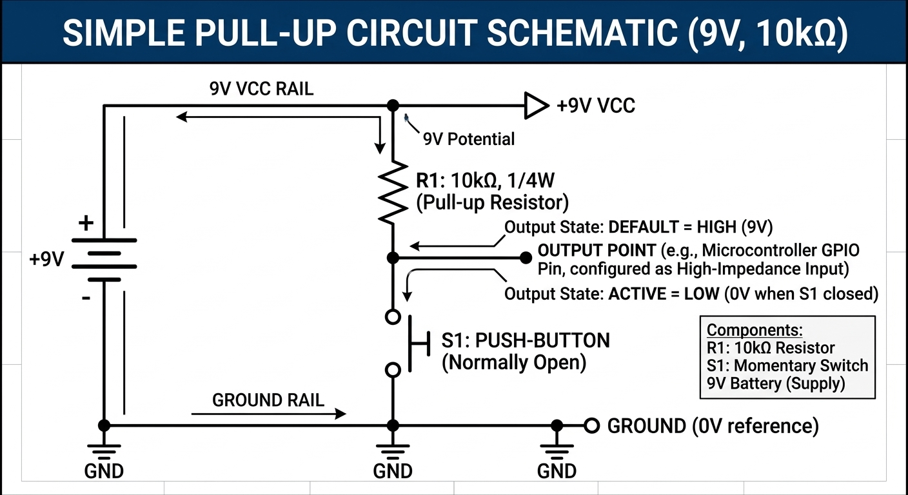

# Field Report: Pull-Up and Pull-Down Resistor Circuits

**Engineer:** Paul A. Jones, Jr.\
**Date:** November 04, 2026\
**Mission:** The objective of this lab is to build and test pull-up and pull-down resistor circuits, measure their behavior under different switch conditions, and verify the results using the voltage-divider equation. Through practical experimentation, I want to understand how these circuits establish reliable HIGH and LOW input states and why that matters for dependable microcontroller operation and interrupt handling.

------------------------------------------------------------------------

## 1. Objective & Context

* **Objective:** Learn what pull-up and pull-down circuits are, where they are used, and what to expect from them through practical bench application.
* **Why This Matters:** Interrupt-driven systems depend upon reliable transitions between known states. Pull-up and pull-down circuits ensure that an input pin has a defined voltage when a switch is open. Without these circuits, the input may float and generate false readings or unintended interrupts. Understanding pull-up and pull-down circuits is therefore a prerequisite to understanding reliable interrupt-based designs.

---

## 2. Part I: The Pull-Up Circuit

### Circuit Setup & Schematics
* **Supply Voltage ($V_{SS}$):** 9V Battery
* **Pull-Up Resistor ($R_1$):** $10\text{k}\Omega$ (Brown, Black, Orange)
* **Load/Test Resistors ($R_2$):** $1\text{k}\Omega$ (Brown, Black, Red)

  
*Figure 1: Pull-Up Resistor Circuit and Measured Junction Voltages.*

### Measured Values

| Switch State | Battery ($V_{SS}$) | Junction Value ($V_J$) | Resistor 1 ($R_1$) | Resistor 2 ($R_2$) |
| :--- | :--- | :--- | :--- | :--- |
| **Open** | 9V | 9.57V | $10\text{k}\Omega$ | $1\text{k}\Omega$ |
| **Closed** | 9V | 0.87V | $10\text{k}\Omega$ | $1\text{k}\Omega$ |
| **Open** | 9V | 9.55V | $1\text{k}\Omega$ | $1\text{k}\Omega$ |
| **Closed** | 9V | 4.73V | $1\text{k}\Omega$ | $1\text{k}\Omega$ |
| **Open** | 9V | 9.55V | $10\text{k}\Omega$ | N/A |
| **Closed** | 9V | 0V | $10\text{k}\Omega$ | N/A |

### Mathematical & Empirical Validation
Using the voltage-divider equation for the closed-switch state with $R_1 = 10\text{k}\Omega$ and $R_2 = 1\text{k}\Omega$:

$$V_J = 9.55 \times \left(\frac{1}{10 + 1}\right) = 0.868\text{V}$$

* **Calculated Value:** $0.868\text{V}$
* **Measured Value:** $0.87\text{V}$
* **Conclusion:** The measured result ($0.87\text{V}$) provides precise experimental confirmation of the voltage-divider equation on the bench.

### Behavioral Breakdown
* **Switch Open:** There is no complete path from the supply voltage to ground. As a result, essentially no current flows through the pull-up resistor. By Ohm's Law ($V = IR$), zero current produces a $0\text{V}$ drop across the resistor ($0 \times 10,000\Omega = 0\text{V}$). The junction remains at nearly the same voltage as the power supply ($9.57\text{V}$ measured), "pulling" the junction toward $V_{CC}$ to create a default logic **HIGH** state.
* **Switch Closed:** Current flows through the resistor to ground, producing a voltage drop that causes the junction voltage to fall near ground potential ($0.87\text{V}$ measured), creating an active logic **LOW** state.

```
Switch Open:                        Switch Closed:
  +9.57V                              +9.57V
    |                                   |
  10kΩ                                10kΩ
    |                                   |
  Junction = 9.57V (HIGH)             Junction = 0.87V (LOW)
    |                                   |
  Open Switch                         Closed Switch
    |                                   |
  Ground                              Ground
```

---

## 3. Part II: The Pull-Down Circuit

### Circuit Setup & Schematics
* **Supply Voltage ($V_{SS}$):** 9V Battery
* **Pull-Down Resistor ($R_1$):** $10\text{k}\Omega$ (Brown, Black, Orange)

  
*Figure 2: Pull-Down Resistor Circuit and Measured Junction Voltages.*

### Measured Values

| Switch State | Battery ($V_{SS}$) | Junction Value ($V_J$) | Resistor 1 ($R_1$) |
| :--- | :--- | :--- | :--- |
| **Open** | 9V | 0V | $10\text{k}\Omega$ |
| **Closed** | 9V | 9.53V | $10\text{k}\Omega$ |

### Behavioral Breakdown
* **Switch Open:** The junction is connected to ground through the pull-down resistor and has no connection to the power supply. With no voltage source applied, the measured voltage remains at $0\text{V}$, "pulling" the junction toward ground to create a default logic **LOW** state.
* **Switch Closed:** A conductive path is established between the power supply and the junction. Current flows through the resistor to ground, and the power supply overrides the pull-down resistor to drive the junction to $9.53\text{V}$ (logic **HIGH**).

```
Switch Open:                        Switch Closed:
  +9.53V                              +9.53V
    |                                   |
  Open Switch                         Closed Switch
    |                                   |
  Junction = 0V (LOW)                 Junction = 9.53V (HIGH)
    |                                   |
  10kΩ                                10kΩ
    |                                   |
  Ground                              Ground
```

---

## 4. Comparative Reference

| Characteristic | Pull-Up Circuit | Pull-Down Circuit |
| :--- | :--- | :--- |
| **Default State (Open)** | HIGH | LOW |
| **Switch Action** | Connects junction to Ground | Connects junction to Power Supply |
| **Active State (Closed)** | LOW | HIGH |

### Summary Rules
* **Pull-Up:** Open $\rightarrow$ No path to ground $\rightarrow$ Junction stays near $V_{CC}$ $\rightarrow$ **HIGH**
* **Pull-Down:** Open $\rightarrow$ No path to $V_{CC}$ $\rightarrow$ Junction stays near Ground $\rightarrow$ **LOW**

---

## 5. Engineering Insights & Lessons Learned

1. **Preventing Floating Inputs:** Pull-up and pull-down circuits establish a known logic state when a switch is open, eliminating high-impedance floating inputs that cause false readings or phantom interrupts.
2. **Resistor Functionality:** A pull resistor does not force current through the circuit; it establishes a default voltage potential when no active path is present. Significant current flows only when an active switch overrides the resistor.
3. **Empirical Verification vs. Nominal Labels:** Component labels provide nominal values, but actual bench measurements reveal real-world behavior and validate theoretical equations like the voltage-divider formula.
4. **Foundation for Interrupts:** Establishing deterministic input states on the bench clears the runway for configuring reliable External, Pin Change, and Timer interrupts without signal noise interference.

---

## 6. Glossary Additions

* **Floating Input:** A digital input whose voltage is not driven to a defined HIGH or LOW state. Floating inputs may produce unpredictable behavior.
* **Logic HIGH:** A voltage interpreted by a digital system as binary 1.
* **Logic LOW:** A voltage interpreted by a digital system as binary 0.
* **Voltage Divider:** A circuit composed of two or more resistors that produces an output voltage that is a fraction of the input voltage.