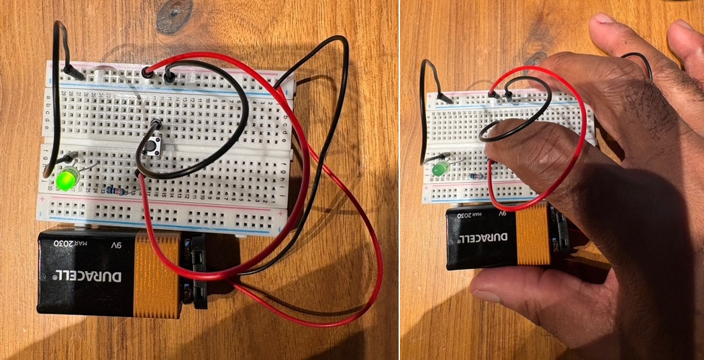
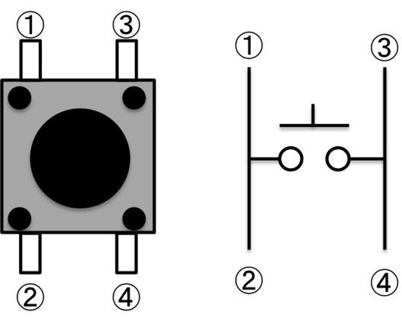

# Field Report: 4-Pin Tactile Push-Button Switch Verification

**Engineer:** Paul A. Jones, Jr.\
**Date:** November 05, 2026\
**Mission:** The mission of this experiment is to understand the internal electrical connections of a four-pin tactile push-button switch, verify its operation through hands-on testing, and observe how it affects a simple LED circuit. The goal is to build a practical foundation for using push-button switches as digital inputs in microcontroller applications.

------------------------------------------------------------------------

## Equipment List

* $1 \times 1\text{k}\Omega$ resistor
* $1 \times 330\Omega$ resistor
* $1 \times$ LED
* $1 \times$ 9V battery ($V_{\text{BAT}}$)
* $1 \times$ 4-pin tactile push-button switch
* Digital multimeter
* Breadboard and jumper wires
* Alligator clips

---

## 1. Objective

Learn how a four-pin tactile push-button switch works, identify its internal contact arrangement, and observe how pressing and releasing the button affects a simple LED circuit.

---

## 2. Initial Circuit Testing

Before connecting the LED and resistor, I built a simple "Do Nothing" test circuit containing only the push-button switch and a path from $V_{\text{BAT}}$ to ground.

### Steps Performed:
1. Wired the push-button switch into the breadboard.
2. Inserted two free wires: one connected to the ground rail and the other connected in the same row as the push-button's power connection.
3. Connected the ground probe of my multimeter to the free end of the ground wire.
4. Connected the positive probe to the free end of the power wire.
5. Observed the voltage with the button released and then pressed.

### Observations:
* When the button was not pressed, the measured voltage approached $V_{\text{BAT}}$.
* When I pressed the button, the voltage fell to approximately $0\text{V}$.

This simple exercise confirmed that pressing the button changed the electrical state at the measurement point. After verifying the switch's behavior in the test circuit, I proceeded with the LED and resistor.

---

## 3. LED Circuit Experiment

With the LED and a $1\text{k}\Omega$ resistor connected, the LED illuminated, although it appeared somewhat dim. I then replaced the $1\text{k}\Omega$ resistor with a $330\Omega$ resistor. The LED became brighter, as expected.

### Observed LED Behavior

| Button Condition | LED Behavior |
| :--- | :--- |
| **Released (not pressed)** | Illuminated |
| **Pressed (depressed)** | Went dark |

*Figure 1: Button Switch Not Pressed vs. Button Switch Pressed.*

---

## 4. Understanding the Four-Pin Switch

During experimentation, I discovered that the four pins are not four independent electrical connections.

The pins are internally arranged in two contact groups:
* The two pins on one side are permanently connected.
* The two pins on the opposite side are also permanently connected.
* Pressing the button connects the two previously separate groups.
* Releasing the button separates those groups.

### Internal Contact Arrangement

The following diagrams illustrate the general arrangement of a four-pin tactile switch.


```
Button Released:

     Contact Group A
       Pin 1 ─── Pin 2  (Connected)

       Pin 3     Pin 4  (Not Connected)
     Contact Group B


Button Pressed:

       Pin 1 ─── Pin 2  (Connected)
             │
       SWITCH CLOSED
             │
       Pin 3 ─── Pin 4  (Connected)
```

*Note: Diagrams illustrate the electrical relationship between the two contact groups, not the physical orientation of every switch model.*

---

## 5. Independent Switch Verification

I wanted to make sure the behavior I observed was actually coming from the switch and not from the breadboard wiring.

To isolate the switch, I removed it from the circuit and used alligator clips to connect its terminals directly to my multimeter. I tested the possible pin combinations, both with the button released and with it depressed.

### Continuity Test Results

| Pin Combination | Button Released | Button Pressed |
| :--- | :--- | :--- |
| **Two pins on the same side** | Continuous beep | Continuous beep |
| **Pins from opposite contact groups** | No beep | Beep |
| **Incorrect connections bypassing switch** | Continuous beep | Continuous beep |

### Key Findings:
1. Pins within the same contact group are permanently connected.
2. The two contact groups are electrically separated when the button is released.
3. Pressing the button connects the two groups.

### Switch Classification

The switch is **Normally Open (NO)** when measured across the two separate contact groups.

| Button Condition | Switch Contact State |
| :--- | :--- |
| **Released** | Normally Open (NO) |
| **Pressed** | Closed |

This independent test confirmed the switch's actual behavior without relying on the LED circuit or breadboard connections.

---

## 6. Engineering Observations & Lessons Learned

1. **Test Components Independently:** Removing the switch from the circuit and testing it directly with the multimeter helped isolate its behavior from the rest of the circuit.
2. **Understand Internal Connections:** A four-pin tactile switch has two internally connected pin pairs. Understanding this arrangement is important when placing the switch across a breadboard.
3. **Normally Open vs. Normally Closed:** The switch contacts I tested are normally open. Pressing the button closes the connection between the two contact groups.
4. **Resistor Selection Matters:** Replacing the $1\text{k}\Omega$ resistor with a $330\Omega$ resistor increased LED brightness. This demonstrated the relationship between resistance and current through the LED.
5. **Component Behavior vs. Circuit Behavior:** The continuity test established what the switch does. The LED experiment showed how the complete circuit responds. These are related observations, but they do not necessarily explain one another.
6. **Verify Assumptions Experimentally:** Although the switch appeared simple, I discovered that learning its internal contact arrangement required direct testing. Measuring continuity revealed behavior that was not immediately obvious from visual inspection alone.

---

## 7. Summary

This experiment gave me an opportunity to understand the physical operation of a four-pin tactile push-button switch before integrating it into a larger circuit.

I verified the switch's contact arrangement using my multimeter, first on the breadboard and then independently using alligator clips. The tests established that the two pins on each side are permanently connected and that pressing the button connects the two separate contact groups.

I also observed how changing the resistor from $1\text{k}\Omega$ to $330\Omega$ affected LED brightness.

With the pull-up/pull-down circuits from the previous lab and the push-button switch from this experiment, I have addressed two important dependencies for my Arduino interrupt experiment. I can now return to that experiment with a better understanding of how the input state is established and how the physical switch changes that state.

> *Measure it. Build it. Test it. Document it.*