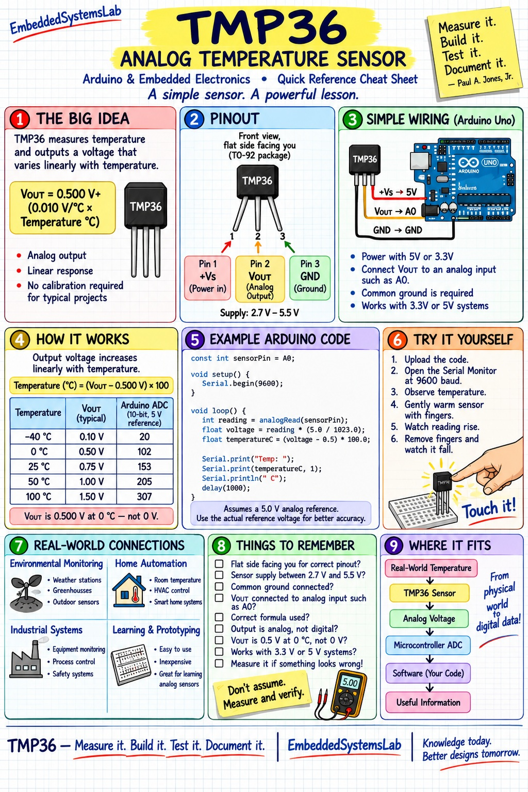

# Empirical Validation of the TMP36 Analog Temperature Sensor

**Author:** Paul A. Jones, Jr.  
*Senior Software & Embedded Systems Engineer*  
*MSE Software Engineering, BS Electrical Engineering, BS Physics*

**Published:** November 20, 2026  
**Report:** #9 — EmbeddedSystemsLab  
**Professional Interests:** Embedded Systems · Arduino · C Programming · Electronics · .NET  
**Contact:** [pauljonessoftware.com](https://pauljonessoftware.com) · `@paulajonesjr` · pauljonessoftware@gmail.com

---

## Technical Infographic

---

## Equipment List

* **TMP36** (TO-92 package)
* **Arduino Uno** ($5.0\text{ V}$ / $3.3\text{ V}$ power rails)
* **Digital Multimeter**
* **Solderless Breadboard**

## Objective

Validate the transfer function and dynamic thermal response of an active solid-state analog temperature sensor (TMP36) using direct multimeter voltage measurements—establishing physical ground truth prior to microcontroller Analog-to-Digital Conversion (ADC) and serial communication integration.

## Architecture & Transfer Function

Unlike passive resistive sensors such as an LDR, the TMP36 is an active, voltage-output temperature sensor. It requires an external supply and ground connection and produces an analog output voltage proportional to temperature. Its low-output-impedance design allows direct interfacing with analog measurement circuitry.

$$
V_{\text{out}} = 0.50\text{ V} + \left(0.01\text{ V}/^\circ\text{C} \times T_{^\circ\text{C}}\right)
$$

Solving for temperature in degrees Celsius:

$$
T_{^\circ\text{C}} = \frac{V_{\text{out}} - 0.50\text{ V}}{0.01\text{ V}}
$$

* **Offset ($0.50\text{ V}$ at $0^\circ\text{C}$):** Allows measurement of sub-zero temperatures without requiring a negative supply rail.
* **Scale Factor ($10\text{ mV}/^\circ\text{C}$):** Independent of supply voltage ($3.3\text{ V}$ vs. $5.0\text{ V}$) within rated operating limits ($-40^\circ\text{C}$ to $+125^\circ\text{C}$).

### Pinout Reference (TO-92 Package, Flat Face Toward Observer)

* **Left Pin ($+V_s$):** Positive DC supply (2.7V –5.5V)
* **Center Pin ($V_{\text{out}}$):** Analog voltage output
* **Right Pin ($\text{GND}$):** Ground reference

## Experimental Procedure & Bench Diagnostics

### 1. Circuit Topology Correction

My initial measurements were unexpectedly low. After reviewing the circuit, I discovered that I had reversed the TMP36's supply polarity. I had carried over some of the wiring habits from the previous voltage-divider experiment and failed to verify the sensor's pin orientation before applying power.

I corrected the wiring, confirmed the pinout against the datasheet, and repeated the measurements. The sensor then produced output voltages consistent with its expected transfer function. Fortunately, the sensor continued to operate normally after the wiring error.

### 2. Package Orientation & Polarity Verification

Subsequent anomalous readings ($0.432\text{ V}$ at $5.0\text{ V}$ and $0.380\text{ V}$ at $3.3\text{ V}$) traced back to reversed sensor pinout orientation on the breadboard. Re-verifying the physical TO-92 flat-face index against the datasheet pinout and re-seating the leads resolved the discrepancy without permanent thermal damage to the silicon die.

### 3. Baseline & Dynamic Thermal Stimulus Testing

With the sensor powered from the Arduino $5.0\text{ V}$ rail and probed directly between $V_{\text{out}}$ (center pin) and $\text{GND}$ (right pin):

| Test Phase | Condition / Stimulus | Measured $V_{\text{out}}$ | Calculated Temp ($^\circ\text{C}$) | Calculated Temp ($^\circ\text{F}$) | Notes |
| :--- | :--- | :--- | :--- | :--- | :--- |
| **Baseline** | Unperturbed ambient room air | $0.733\text{ V}$ | $23.3^\circ\text{C}$ | $73.9^\circ\text{F}$ | Stable steady-state output |
| **Initial Stimulus** | Brief pinch on plastic package | $0.740\text{ V}$ | $24.0^\circ\text{C}$ | $75.2^\circ\text{F}$ | $+7\text{ mV}$ initial thermal rise |
| **Sustained Stimulus** | 15-second pinch on plastic body | $0.771\text{ V}$ | $27.1^\circ\text{C}$ | $80.8^\circ\text{F}$ | $+38\text{ mV}$ peak; heat soaked into die |
| **Recovery** | Released to ambient air | $\rightarrow 0.733\text{ V}$ | $\rightarrow 23.3^\circ\text{C}$ | $\rightarrow 73.9^\circ\text{F}$ | Smooth linear decay back to baseline |

## Key Engineering Takeaways

* **Active vs. Passive Topology:** Active sensors regulate their own output stage and require direct, unattenuated supply rails—never series current-limiting resistors in the power path.
* **Physical Package Verification:** Always verify the physical index marking (flat face of the TO-92 package) directly against the component datasheet before applying power; swapped $+V_s$ and $\text{GND}$ leads can forward-bias internal protection junctions and damage the die.
* **Thermal Time Constant:** The epoxy TO-92 casing introduces thermal lag; a sustained 15-second contact is required for body heat to conduct through the package into the internal silicon sensor.
* **ADC Readiness:** Establishing the $0.733\text{ V}$ ($23.3^\circ\text{C}$) and $0.771\text{ V}$ ($27.1^\circ\text{C}$) anchor points on a calibrated multimeter provides an exact reference standard to validate `analogRead()` quantization and reference voltage ($V_{\text{ref}}$) math in the next stage.

## Embedded Systems Engineering Glossary

* Refactored my **Embedded Systems Engineering Glossary** to include a handful of new serial communications-related terms.
* Reorganized it to make it more searchable.
* Updated it in GitHub.
